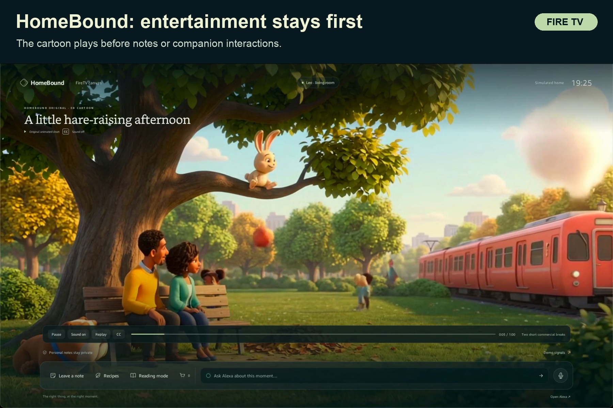

# HomeBound

**A Fire TV canvas for the right person, at the right moment.**

HomeBound brings family notes, cooking help, scene shopping, and room previews
into the shared living-room screen. Notes wait for a commercial, personal text
stays private when a guest joins, and Amazon Bedrock interprets conversational
requests against the current scene. An Alexa-style voice companion shares the
same home state.

Built for **Build, Ship, Shape: Amazon Developer Hackathon**, with **Fire TV as
the primary track** and Alexa+ as a complementary stack. The Amazon Vega app in
[`apps/firetv`](apps/firetv/) loads the real canvas in WebView on Vega Virtual
Device. Household signals and room controls are labelled simulations; Alexa+
partner access remains unconnected.



[Watch the 2:51 Fire TV demo](https://youtu.be/z0_36x-JmDA), recorded from the
installed application on Amazon Vega Virtual Device.

## Try it

Use Python 3.12 or 3.13 and Node 22.23.2. Start a visual preview without cloud
credentials:

```bash
python3 -m venv .venv
.venv/bin/python -m pip install -r requirements-dev.lock
.venv/bin/python -m pip install --no-deps -e .
.venv/bin/python -m app.cli.web
```

Open [the TV canvas](http://127.0.0.1:8300/tv?play=park_chase). **Demo signals**
selects the audience, scene, and pantry. Natural-language requests use a real
Bedrock model and require the configuration in [deployment.md](docs/deployment.md).
The alternative `docker compose up --build` packages the same preview on localhost.

For the actual TV application, follow the [Vega setup and install steps](apps/firetv/README.md).
The [submission guide](docs/submission/README.md) contains the judge walkthrough,
source bundle, narration, product feedback, and verified status.

## Everyday TV uses

- A homework reminder appears during a commercial, with pause and exact resume.
- A guest joining removes personal notes from the server's response.
- “What are they cooking?” connects the illustrated scene to the demo pantry.
- “I like that jacket” opens an item; a follow-up adds it to a draft cart.
- “I want to read a book, but keep the game on” previews captions, audio, and lights.
- The Alexa-style companion leaves a note that appears for its intended viewer.

Catalog prices, pantry, audience, and room settings are demo data. No purchase,
physical lighting change, third-party streaming overlay, or real device operation
is represented as completed. See the [canvas behavior and boundaries](docs/firetv-canvas.md).

## Architecture

```text
Vega Fire TV app (WebView)        Alexa-style companion (optional Deepgram voice)
                    \             /
                Shared Python web service
                          |
             Amazon Bedrock Converse proposals
                          |
             Bounded Context / Media / Shopping
                          |
      Durable home state -> audience-filtered TV projection
```

The model proposes an interaction; deterministic code owns audience eligibility,
expiry, playback transitions, and draft-cart totals. Private notes are filtered
before reaching the TV. Optional AgentCore, EventBridge, SQS, Lambda, and
published Guardrails infrastructure is supplied in
[`infra/firetv`](infra/firetv/); see [current validation](docs/submission/status.md)
for deployed versus packaged components.

A separate governed device path remains available for future home integrations:
Bedrock → MCP → official Decionis AgentSafe → Decionis authority → local Ring
simulator. It verifies signed dossier evidence before simulated execution.
Decionis manages Presence; HomeBound neither calls Presence directly nor stores
its credentials. The sections below retain that integration's setup and history.

## Project phases

Work is delivered in stacked pull requests:

1. [Phase 1 — Bedrock orchestration and MCP](https://github.com/ocularminds/homebound/pull/1)
2. [Phase 2 — Decionis AgentSafe and managed Presence](https://github.com/ocularminds/homebound/pull/2)
3. [Phase 3 — Ring simulator, verified dossier archive, and end-to-end demo](https://github.com/ocularminds/homebound/pull/3)
4. [Phase 4 — Runtime hardening and Bedrock model compatibility](https://github.com/ocularminds/homebound/pull/4)
5. [Phase 5 — Live service validation](https://github.com/ocularminds/homebound/pull/6)
6. [Phase 6 — Policy source boundary](https://github.com/ocularminds/homebound/pull/7)
7. [Phase 7 — Production policy publication and home binding](https://github.com/ocularminds/homebound/pull/8)
8. [Phase 8 — Owner policy version synchronization](https://github.com/ocularminds/homebound/pull/9)
9. [Phase 9 — Live Bedrock, Alexa+, and Presence validation](https://github.com/ocularminds/homebound/pull/11)
10. [Phase 10 — Alexa+ CodeArtifact role-assumption diagnosis](https://github.com/ocularminds/homebound/pull/13)
11. [Phase 11 — Alexa-style voice simulator](https://github.com/ocularminds/homebound/pull/14)
12. [Phase 12 — Managed escalation interface](https://github.com/ocularminds/homebound/pull/16)
13. [Phase 13 — FireTV ambient canvas and AWS supervisor](docs/firetv-canvas.md)

## Separate governed-device demonstration

`python -m app.demo` starts the local AgentSafe executor and dossier archiver, Ring simulator, and MCP server. It then asks the configured Bedrock model to make exactly one MCP request for each scripted scenario. The model must preserve the fixture arguments; a mismatch stops the scenario before MCP. Outcomes still come from the configured Decionis tenant and policy—HomeBound does not hard-code a decision.

1. **Kids Home Alone:** at home at 15:00, a child requests `disarmSystem(home_security)`. Decionis should return `ESCALATE`. A parent approves in Decionis Presence; the demo resumes the saved AgentSafe handoff, and only a terminal authorized grant permits the simulated disarm.
2. **Courier, authorized window:** the camera recognizes an expected courier. Alexa asks the resident to confirm opening the side gate. At 16:00 home-local time, Decionis should return `ALLOW`; the simulator unlocks the gate.
3. **Courier, wrong time:** the same recognized courier and resident confirmation arrive at 18:01 home-local time. Decionis should return `BLOCK`; no simulator action runs and the side gate remains locked.

The deterministic fixture labels courier recognition as camera-sourced and records a resident confirmation requested by the voice assistant. These are still demo claims passed through MCP, not independent proof. A deployment must bind them to authenticated camera and household sources before using them to authorize a real device. The local-time signal must come from the configured home's timezone, not the agent.

## HomeBound policy examples

[`policies/homebound-household-zero-trust.yaml`](policies/homebound-household-zero-trust.yaml) is a **public-demo-only** Decionis Policy Exchange example. It demonstrates vendor-neutral capabilities (`home.security.disarm`, `home.entry.unlock`) and household targets (`home_security`, `side_gate`), so the same example can describe Ring or another home-device adapter. It defaults to shadow mode. It is not copied into customer workspaces and is not the source of production policy. The current MCP server does not expose the guide's camera-only `disable`, `toggle_off`, or `delete_footage` actions.

Real household policy lives in Decionis Protocol as a versioned, org-scoped policy bundle. Version `homebound-household-v1` has been published to the configured tenant by merging the five HomeBound rules into its existing bundle; the three Commerce rules were preserved. The local publisher records the verified `home_id`, `org_id`, `bundle_id`, and policy version in the ignored `.homebound/policy-binding.json`, then the MCP server places that binding in every AgentSafe intent for audit. After an owner publishes a workspace update, the sync command records which active org policy version is associated with this home and appends that association to the private home-binding history. Policy remains org-scoped; this history does not create a separate per-home policy. Decionis remains the authority and selects the active org policy; the binding is a reference record, not an authorization grant. Policy submission uses [`POST /v1/protocol/policies/bundles`](https://docs.decionis.com/policy-encoding). Policy Exchange remains a public catalog for demo examples; it does not provision or update production tenant policy.

[`policies/homebound-household-policy.rules.json`](policies/homebound-household-policy.rules.json) is the source for those vendor-neutral Protocol rules. The publishing script validates the candidate against Decionis, preserves existing tenant rules, submits a new version, verifies the stored rule IDs, and writes the private home binding. It refuses to publish if the active tenant bundle differs from the reviewed Commerce bundle.

Publish or re-verify from the project root:

```bash
python scripts/publish_homebound_policy.py       # validate only
python scripts/publish_homebound_policy.py --publish
```

The publisher reads credentials from ignored `agentsafe/.env`; it never prints credentials or the tenant ID. The child's rule escalates through Decionis-managed Presence with the `APPROVER` role and a 60-second authority expiry. HomeBound does not invent a Presence API call or local approval. Parent email enrollment and role synchronization remain owned by the Decionis workspace for this prototype. The direct parent-role allow rule stays disabled until HomeBound has an authenticated parent identity claim.

The policy uses the default home-local delivery window of 14:00–18:00. Decionis compares integer minutes after midnight (840–1080); the demo also retains the readable `HH:MM` value in its proposal record. After an owner edits and publishes the org policy in the Decionis workspace, preview and apply the active org policy version to this home's local binding with:

```bash
python scripts/sync_home_policy_binding.py
python scripts/sync_home_policy_binding.py --apply
```

The sync command reads Decionis' decision register, confirms the active version matches the listed bundle, and refuses to sync if any HomeBound rule is missing. `--apply` updates only the private local home-to-org-policy binding and its association history; it does not publish or change Decionis policy or create per-home rules. The current AgentSafe package still cannot pin an exact requested policy version on each action. Camera recognition and the voice assistant's confirmation are separate inputs; timezone, courier identity, and expected-delivery status must be bound to trusted sources before authorizing a real device. Bedrock/MCP fixtures are claims, not independent evidence. The simulator is the only downstream configured here.

Parent emails are household configuration, not public Policy Exchange data. For the prototype, the household owner can enroll parents in the Decionis workspace and assign Presence's `APPROVER` role there; a HomeBound owner UI can provide the same flow later. Decionis resolves that role during its native managed escalation. This repository's CLI does not manage the roster, and its AgentSafe demo remains configured with one trusted approver ID.

The simulator is not Ring hardware and does not contact Ring's API. It persists simulated device state, execution events, and replay fingerprints in a local SQLite database.

## Run the governed-device demonstration

Requirements: Python 3.12+, Node.js 22.14+, AWS credentials permitted to call Bedrock Runtime, an enabled Converse tool-use model, a Decionis tenant/API key, and the household policy/approver configured in that tenant. The Python dependencies include `botocore[crt]` so boto3 can use AWS CLI `aws login` profiles.

Install the Python package and create the local configuration files:

```bash
python -m venv .venv
source .venv/bin/activate
python -m pip install -r requirements-dev.lock
python -m pip install --no-deps -e .
[ -f .env ] || cp .env.example .env
[ -f agentsafe/.env ] || cp agentsafe/.env.example agentsafe/.env
```

The checked-in example selects the `Decionis` AWS CLI profile and Amazon Nova Lite inference profile for `us-east-1`. Replace these values if using a different profile or enabled model. The Nova Lite path was revalidated with a real scene request during submission preparation on 23 October 2026.

```bash
aws login --region us-east-1 --profile Decionis
export AWS_PROFILE=Decionis
```

In `agentsafe/.env`, set the real `EXECUTOR_TENANT_ID`, server-side `DECIONIS_API_KEY`, trusted household `PRESENCE_APPROVER_ID`, and strong random values for `EXECUTOR_CALLER_TOKEN`, `DOWNSTREAM_CREDENTIAL`, `HOMEBOUND_DOSSIER_ARCHIVER_TOKEN`, and `HOMEBOUND_SIMULATOR_DEMO_TOKEN`. Set the matching AgentSafe and archive bearer values in the root `.env` as shown by its comments. Keep both `.env` files local; they are ignored by Git.

The policy publisher validates and installs the current household rules. Confirm that the configured parent has the Decionis workspace `APPROVER` role before completing a Presence test. The publisher preserves other tenant rules and refuses to replace an unexpected policy bundle.

Install the pinned official Node dependencies and run the stack:

```bash
fnm use 22.23.2
(cd agentsafe && npm ci)
set -a && source .env && set +a
python -m app.demo
```

The first scenario pauses at the terminal while the parent completes the Presence approval. Press Enter after completing the Presence flow to have AgentSafe recheck the original handoff. The demo reports the initial and final decisions, execution result, correlation ID, and dossier identifier. A missing credential, invalid dossier proof, uncertain authority result, or changed proposal fails closed.

For local unit/integration coverage:

```bash
python -m pytest -q
(cd agentsafe && fnm exec --using=22.23.2 npm run check)
```

These tests use local fixtures for external Decionis and AWS responses; they do not claim a live authority or Presence transaction. Live integration validation requires the tenant, policy, approver, AWS profile, and model access listed above.

## Authorization and evidence

- AgentSafe constructs the Execution Intent Envelope and owns exact-action binding, grant claiming, expiry, idempotency, escalation resume, and the only downstream dispatch path.
- The simulator requires the authorization identifiers and exact action metadata bound by AgentSafe, records the grant ID and expiry, and rejects an expired grant. It refuses direct calls, missing evidence, request mutation, and idempotency-key reuse with changed content. AgentSafe owns one-time grant consumption; its grant token never leaves the trusted process.
- Before dispatch, the executor retrieves the org-scoped [Decionis Decision Dossier](https://decionis.com/docs/decision-dossier) and tenant-bound proof packet. The official [`@decionis/verify`](https://www.npmjs.com/package/@decionis/verify) package checks the packet's signed artifacts against Decionis' pinned production JWKS. Signature validity, required-artifact coverage, and the Decionis trust anchor must all pass; otherwise dispatch stops.
- The exact dossier and proof-packet responses, verifier result, and hashes are retained under the local ignored `audit/dossiers/` directory. Python also appends action, decision, approval result, execution event, and dossier evidence to `audit/actions.jsonl`; AgentSafe keeps its own journal. These local artifacts contain sensitive household activity and are private to the developer machine.
- `BLOCK` never calls the simulator. `ESCALATE` never calls it until Presence has completed and AgentSafe returns authorization for the same handoff. The demo uses a separate reset token only to restore the simulated baseline between scenarios.
- No signature is synthesized in the simulator. Tests inject verifier responses only at the unit-test boundary; local live execution uses Decionis' dossier response and the official verifier.

## Integration status and boundaries

- **Web and voice:** full-screen Alexa-style simulation with time-based greetings, continuous listening between replies, Deepgram speech, and context gathered through conversation. The dialogue interpreter cannot invoke devices; the server binds a ready request before the governed MCP path. Voice requires a server-side Deepgram key and browser microphone/audio permission. Home details shows conversation claims, execution snapshots, and action evidence. See [setup and boundaries](docs/web-simulator.md).
- **FireTV canvas:** person-aware notes, attention-aware layouts, draft scene shopping, pantry recipes, room previews, and break dashboards run locally at `/tv`. Bedrock receives public scene metadata and the simulator's own illustrated frames for scene requests. Private note retrieval and guest redaction happen on the server. AgentCore, EventBridge, and published Guardrails adapters are included; the deployed cloud route, physical FireTV/Ring/Alexa+ controls, live feeds, and Amazon Pay remain unconnected. See [behavior, AWS setup, and validation](docs/firetv-canvas.md).
- **MCP:** real Python SDK Streamable HTTP server, declarative `unlockDoor`, `disarmSystem`, and `viewStream` tools, plus a governed escalation-resume tool.
- **Action binding:** the public MCP tools retain their declarative names. The official AgentSafe intent schema requires lowercase action identifiers, so the signed Decionis intent binds vendor-neutral capabilities `home.entry.unlock`, `home.security.disarm`, or `home.camera.view_stream`; the execution adapter maps the authorized identifier to the current Ring simulator operation. Future vendor adapters can implement the same capabilities without changing household policy.
- **Orchestration:** real Amazon Bedrock Converse tool-use integration; the configured US Nova Lite profile is active and returned a live response. Alexa+ itself is not activated in this repo. Amazon currently limits Alexa+ add-on tooling to selected partners; the documented private CodeArtifact role assumption is still denied for the provisioned IAM user (see [FL-028](friction-log/FL-028-alexaplus-partner-access.md) and [FL-030](friction-log/FL-030-alexaplus-role-assumption-denied.md)). No Alexa+ production integration is claimed.
- **AgentSafe / Decionis / Presence:** official AgentSafe executor and live Decionis authority. The managed escalation implementation delegates to native Decionis Presence; HomeBound does not call Presence directly or hold a Presence API credential. The web simulator now shows pending approvals, checks saved handoffs by voice or automatically, and announces terminal results. The live child request is blocked before handoff by `PRESENCE_TENANT_CONNECTION_NOT_CONFIGURED` (HTTP 503), diagnosed in [FL-032](friction-log/FL-032-presence-tenant-connection-and-web-escalation.md). The Decionis tenant needs its Presence connection configured before a real ceremony can run. See the [approval lifecycle](docs/escalation.md). Parent role enrollment remains managed in the Decionis workspace (FL-022).
- **Ring:** local simulator only. No physical Ring SDK, account, device, camera stream, or door is contacted.
- **Household signals:** demo context is a deterministic fixture. Production use needs authenticated signals and a tenant policy that accounts for signal provenance.
- **Policy binding:** the publisher records the verified home, org, bundle, and version reference locally, and AgentSafe hashes it with each intent. Policy remains org-scoped. Owners publish the org policy in the Decionis workspace, then the sync command records which org version is associated with this home. The current AgentSafe package does not expose Decionis' requested-policy-version selector or return the selected version to HomeBound, so this binding cannot pin or independently verify an exact version at action time.
- **External validation:** Decionis accepted and stored the versioned HomeBound rules in the existing tenant bundle, preserving Commerce rules. Direct shadow evaluations matched child `ESCALATE`, valid-window courier `APPROVE`, and wrong-time courier `REJECT`. Live MCP → AgentSafe → Decionis → simulator checks allowed the 16:00 courier and unlocked only the simulated side gate; the independently verified dossier had complete artifact coverage and the official Decionis trust anchor. The 18:01 courier was blocked and the gate remained locked. The active org-version read matched the home binding. A later child disarm request failed closed with `AUTHORITY_REQUEST_FAILED`; no Presence request opened and the Ring simulator remained untouched (FL-029). The exact configured Bedrock Nova Lite profile now returns a live Converse response in `us-east-1` (FL-015). No physical Ring device is configured, and the human Presence approval ceremony remains unvalidated. See [FL-016](friction-log/FL-016-agentsafe-action-name-contract.md), [FL-017](friction-log/FL-017-live-tenant-managed-presence-policy.md), [FL-019](friction-log/FL-019-mcp-context-signal-provenance.md), [FL-023](friction-log/FL-023-protocol-rule-paths-and-numeric-time.md), [FL-025](friction-log/FL-025-agentsafe-policy-binding-schema.md), [FL-026](friction-log/FL-026-protocol-proof-packet-contract.md), [FL-027](friction-log/FL-027-owner-policy-version-sync.md), [FL-028](friction-log/FL-028-alexaplus-partner-access.md), and [FL-029](friction-log/FL-029-live-presence-escalation-attempt.md).

## Friction Log Summary

Implementation issues and workarounds are tracked in [`friction-log/`](friction-log/). Policy Exchange remains a public playground artifact; production policy is org-scoped in Decionis Protocol, while HomeBound records a private home-to-org-policy binding and its version associations (FL-020, FL-027). Parent email-to-Accounts identity resolution and Presence `APPROVER` management remain in the Decionis workspace for this prototype (FL-022). Bedrock inference is active for the configured Nova Lite profile (FL-015). Alexa+ remains blocked on selected-partner and private registry access; the documented Amazon role assumption is denied for the provisioned IAM user (FL-028, FL-030). The live HomeBound bundle preserves existing Commerce rules. FL-023 records the rule-path and numeric-time corrections; exact policy-version pinning through the current AgentSafe package remains an upstream integration limitation. FL-025 and FL-026 record and resolve the live AgentSafe schema and dossier proof-packet contract mismatches. MCP context signals stay claims unless authenticated sources are connected (FL-019). The child rule matched in shadow mode, but the fresh live attempt failed closed before Presence (FL-029); no mock authority decisions or signatures are used.

## License

HomeBound original source code is available under the [MIT license](LICENSE).
See [third-party notices and media provenance](THIRD_PARTY_NOTICES.md).
