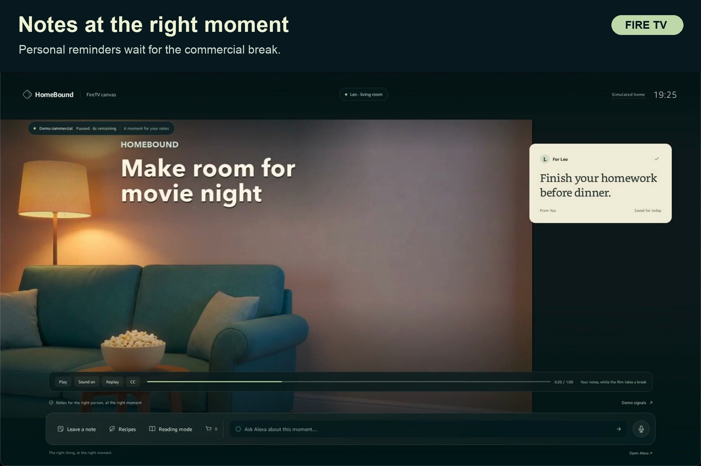
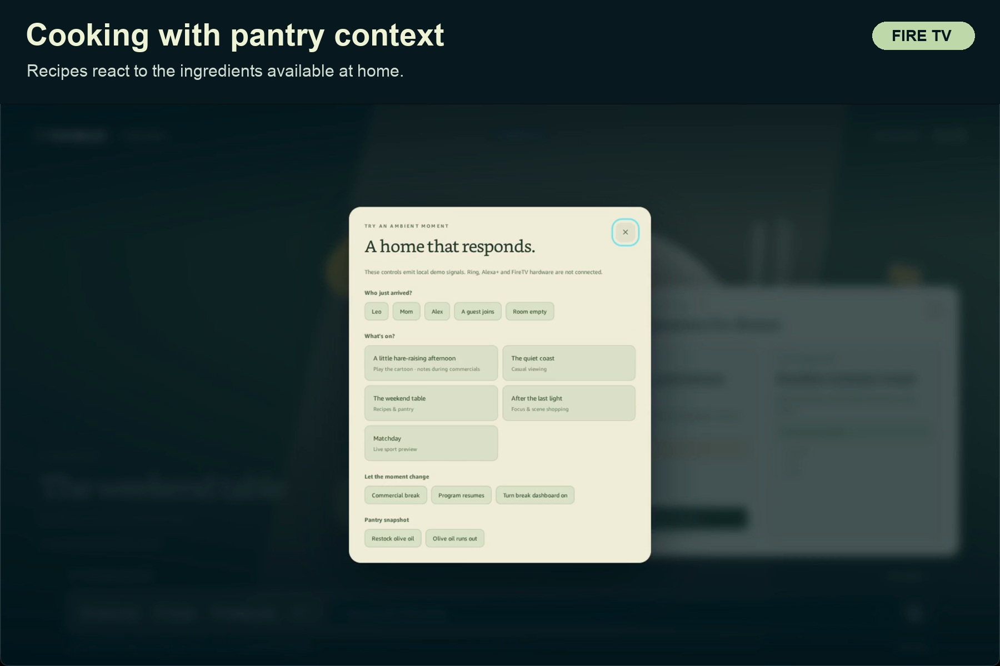
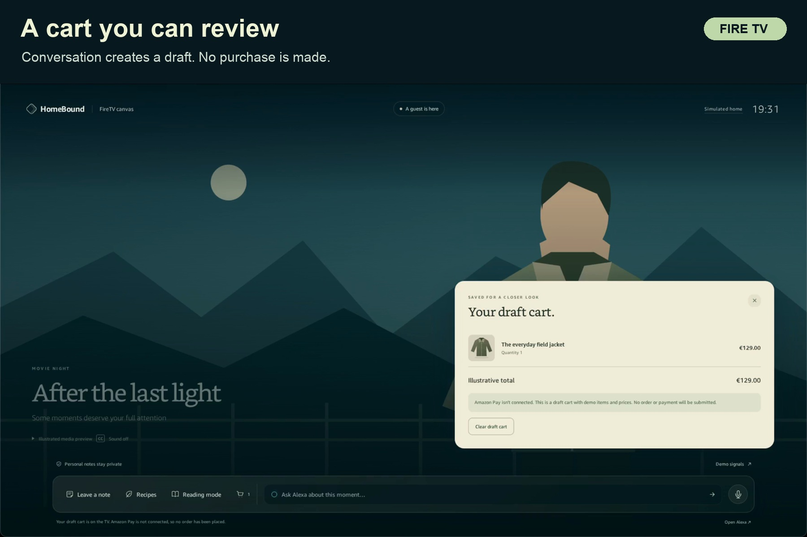
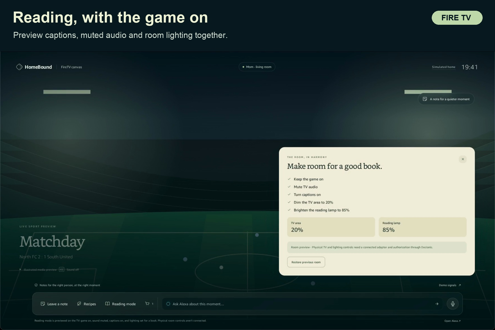

# Fire TV gallery

These images use frames from the installed HomeBound application on Amazon
Vega Virtual Device. Each title is placed above the captured interface.

## Picture 0: the cartoon plays first

The opening frame shows real cartoon playback before any note or companion
interaction. Entertainment remains the starting point of the experience.

## Notes at the right moment

Leo's reminder appears during a commercial. Personal notes disappear when a
guest joins, with audience filtering performed before the server sends data.

## Cooking with pantry context

Live Bedrock interpretation matches recipes to the illustrated scene. The
open recipe reacts when the demo pantry is restocked.

## A cart you can review

A conversational follow-up adds the jacket to a draft cart. Amazon Pay is
unconnected; no order or payment is submitted.

## Reading, with the game on

Reading mode previews captions, muted audio and lighting while keeping the
game. A follow-up restores the previous room. Physical controls need adapters.
